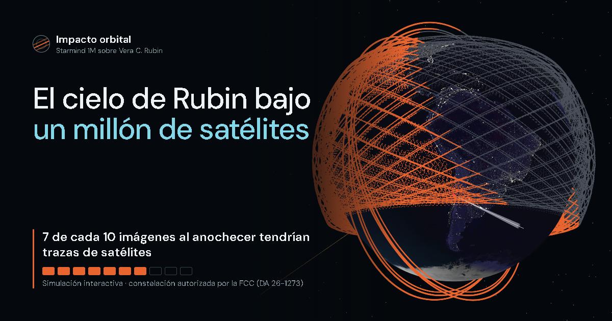

# Orbital impact · Starmind over Vera C. Rubin

[Español](README.md) · **English**

[](https://hungerforcoffe.github.io/starmind_demonstration/)

Interactive 3D simulator of the damage SpaceX's **Starmind** megaconstellation would cause to observations at the **Vera C. Rubin Observatory** (Cerro Pachón, Chile). Starmind covers up to 1,000,000 satellites operating as orbital data centers; the FCC authorized it on 25 Nov 2026 (DA 26-1273).

### ▶ [Open the simulator](https://hungerforcoffe.github.io/starmind_demonstration/)

It runs in the browser with nothing to install. The interface is in Spanish (see the glossary below).

---

## Motivation

Existing studies of megaconstellations and astronomy (Tyson et al. 2020; Hainaut & Williams 2020; Bassa et al. 2022) deal with tens of thousands of satellites. Starmind is more than an order of magnitude larger and adds sun-synchronous shells that stay sunlit through twilight. The project aims to:

1. **See** the full constellation at true scale, around the Earth and in Rubin's sky, at any date and time.
2. **Quantify** its effect on LSSTCam images (streaks per exposure, saturation and lost-pixel fraction) through a traceable calculation chain. Every parameter is tagged with its source and whether it is confirmed data or an assumption.

## Key results (night of 26/27 Nov 2026)

Starmind only, 200 random pointings above 30° altitude, 30 s exposures:

| Time (Chile) | Sun | All 6 shells: images with streaks (of 10) · streaks per image | Shells below 600 km only |
|---|---|---|---|
| 21:30 | −12.7° | 6.9 · 29.9 | 6.7 · 3.9 |
| 22:00 | −17.9° | 6.8 · 28.8 | 6.0 · 3.2 |
| 22:30 | −22.8° | 4.3 · 18.9 | 2.5 · 1.1 |
| 23:00 | −27.2° | 1.4 · 9.8 | 0.1 · 0.1 |
| 00:00 | −34.2° | 0.1 · 0.5 | 0 · 0 |
| 01:30 (solar midnight) | −38.6° | 0 · 0 | 0 · 0 |
| 04:00 | −27.3° | 1.7 · 8.8 | 0.1 · 0.0 |
| 04:30 | −22.9° | 4.5 · 19.1 | 2.5 · 1.3 |
| 05:00 | −18.1° | 6.7 · 24.0 | 6.3 · 3.3 |

- **The damage is concentrated in the hours after dusk and before dawn.** At midnight the Earth's shadow above Rubin's zenith never drops below ~1,550 km, while Starmind orbits at ≤ 1,002 km.
- **At the end of astronomical twilight (22:01)** about 6,400 Starmind satellites are sunlit above 30°. Current Starlink (11,189 satellites) gives ~30–50, and ~0.3 streaks per image.
- **The upper shells are what stretch the problem into the night.** With only the shells below 600 km, the only ones whose debris plan has been approved so far, the affected period ends ~1 h earlier in the evening and starts ~1 h later in the morning. At dusk the fraction of affected images barely changes, but there are about 9 times fewer streaks per image.
- **Brightness is the largest uncertainty.** The AI1 satellite's brightness has not been measured; the plausible range is M₁₀₀₀ = 2.7–6.0, about 3 magnitudes. The number of streaks does not depend on brightness; saturation and masking do. In the same field, the lost image fraction can go from ~1 % to ~20 % between the central and pessimistic cases.

## How to use it

### Simple mode (for anyone)

- **Constellations:** checkboxes for Starmind, current Starlink and Starlink Gen2. The page starts with Starmind only. For Starmind you choose between all its shells and only those below 600 km.
- **Time:** a slider runs through the night, from sunset to sunrise.
- **Estimated impact:** "X out of 10 images would show satellite streaks", plus the average number of satellites per photo, computed live from 200 random pointings.
- **Exposure:** tapping a point in the sky takes a 30 s exposure there and shows what LSSTCam would see. On load it shows a typical example: of 31 random fields, the one with the median number of streaks.
- **Lost image:** shown for two cases side by side, "if the satellites are darkened like current Starlink" and "if they are not darkened".

### Advanced mode ("Avanzado")

- **Time:** any date and time, accelerated playback and shortcuts (end of twilight, solar midnight, start of dawn, winter solstice).
- **Scenarios:** checkboxes, Starmind shells, a deployed-fraction slider following the FCC milestones, a layer editor (altitude, inclination, N, planes, LTAN) and live TLE refresh from CelesTrak.
- **Earth's shadow:** cylindrical or conical with penumbra. It changes which satellites are sunlit.
- **LSSTCam:** click the sky or enter alt/az or RA/Dec (J2000) to point and expose. Under the image are Starmind's brightness (optimistic 6.0, central 5.7, pessimistic 2.7 or custom), the u–y band, 1 × 30 s or 2 × 15 s exposure and the Mallama 2023 phase function. These only change how each satellite looks, not how many cross the field.
- **Tabs:**
  - **Night chart:** sunlit satellites above 30° and streaks per exposure through the night, per scenario.
  - **Exposure:** details of the last exposure and statistics over N random pointings.
  - **Sources & assumptions:** every parameter with its status and source.
  - **Diagnostics:** automated in-page tests, each reporting pass or fail.

### Phones

The page detects phones and draws 1 in 10 Starmind satellites so the views stay smooth. Numbers are always computed with the full constellation.

### URL parameters

| Parameter | Effect |
|---|---|
| `?modo=simple` · `?modo=avanzado` | Opens in that mode (default: simple; the page remembers the last choice) |
| `?t=2026-11-27T01:00:00Z` | Opens at a given UTC date and time (default: today's end of astronomical twilight) |
| `?diag=1` | Opens advanced mode and runs the diagnostics |
| `?lite` · `?full` | Forces the light phone mode, or disables it |

### UI glossary

| Spanish | English |
|---|---|
| Constelaciones en el cielo · Todas sus capas · Solo bajo 600 km | Constellations in the sky · All shells · Below 600 km only |
| Hora en Cerro Pachón · puesta / salida del sol | Time at Cerro Pachón · sunset / sunrise |
| Impacto estimado · X de cada 10 imágenes saldrían con trazas | Estimated impact · X out of 10 images would show streaks |
| Elige dónde apuntar · Lo que vería LSSTCam | Choose where to point · What LSSTCam would see |
| Modo simple / avanzado | Simple / advanced mode |
| Gráfico de la noche · Exposición · Fuentes y supuestos · Diagnóstico | Night chart · Exposure · Sources & assumptions · Diagnostics |
| iluminado / en sombra · traza | sunlit / in shadow · streak |

## What the FCC says (DA 26-1273, 25 Nov 2026)

Checked against the full text of the authorization and of public notice DA 26-113:

- **What was authorized.** Up to 1,000,000 satellites in 50 km shells between 500 and 1,002 km, in 6 groups: 550–568 km at 26–32°; 565–585 km at 97.7°; 686–718 km at 30°; 707–744 km at 97.2°; 946–978 km at 30°; 967–1,002 km at 99.4°. The shell grid comes from a SpaceX letter dated 29 May 2026.
- **How the satellites are split.** The order does not say how many go in each shell. The simulator uses McDowell's list of 114 subshells scaled to the cap: 999,996 satellites with whole numbers per plane. Orbital planes were left out of Schedule S: the FCC granted the waiver "due to technical limitations in the Schedule S software" (condition 7).
- **Orbital debris and the 600 km split.** The FCC approved the debris plan only for satellites below 600 km (¶11). To deploy any of the 4 upper shells SpaceX must file a modification with a final plan, and its request to dispose of them into disposal or heliocentric orbits was deferred (condition 4). That is why the simulator includes the "below 600 km only" scenario.
- **Test deployment.** SpaceX will test satellites at lower altitude, "below other operational systems", before raising them to their shell (¶12–13). The steady-state model does not include this transient population.
- **Milestones.** First satellite operating by 25 Nov 2033, 10 % by 2035, 50 % by 2038 and 100 % by 2040 (condition 10). The 15-year license term is a legal period, not each satellite's lifetime (condition 11).
- **Optical astronomy.** No conditions at all: the FCC deems SpaceX's commitment to coordinate with the NSF sufficient (¶16) and declares the thermal infrared raised by the AAS outside its purview (¶17). It denied the petitions of the AAS, Amazon Kuiper and Viasat (¶20).
- **Brightness.** Dark Sky notes that SpaceX made no commitment to reduce reflectivity, and the FCC imposes nothing on it (note 52). That is why the central case, which assumes mitigation like the Starlink V2 Mini's, is always shown next to the pessimistic one.
- **Interagency consultation.** The FCC considers the formal consultation requested by astronomers satisfied by coordination through NTIA with NASA, NOAA and "federal astronomical organizations" (note 51).
- **Other objections.** It dismisses the SKA's radio-reflection objection for lack of technical support (¶5) and calls the atmospheric effects of re-entry "speculative" (¶15).
- **Future data.** SpaceX must report conjunctions, maneuvers and the orbital parameters of everything deployed every 6 months (condition 6). Once deployment begins, that will be a source of real data for the simulator.
- **Internal inconsistency.** The cover page and public notice date the application 30 Jan 2026; a footnote in the body of the order says "Jan. 20".

The row-by-row review (in Spanish) is at the end of [`FASE1_FASE2.md`](FASE1_FASE2.md).

## Physical model

| Component | Implementation |
|---|---|
| Starmind / Gen2 orbits | Circular, with secular J2 precession of the node and argument of latitude. Sun-synchronous shells keep RAAN fixed relative to the Sun (LTAN 18:00 / 06:00) |
| Current Starlink | SGP4 (satellite.js) on CelesTrak TLEs; bundled snapshot or live download |
| Time and frames | GMST IAU-82, IAU 1976 precession, WGS-84 observer |
| Sun | Astronomical Almanac low-precision formula (~0.01°) |
| Shadow | Cylindrical (default) or conical (umbra and penumbra with a linear transition) |
| Brightness | m = M₁₀₀₀ + 5 log₁₀(ρ/1000 km) − 2.5 log₁₀(f_lit), with an optional phase function |
| Streaks | Intersection of the 30 s path segment with the LSSTCam field, in the tangent plane |
| Photometry | Per-band zero point, 0.67″ PSF, defocus 206265·D/ρ with D = 8.36 m, full well 130,000 e⁻ |
| Masks | 20″ (normal), 100″ (saturated), whole CCD if m < 2 (Jangid et al. 2026 convention) |

Propagation runs in a WebGL vertex shader, and the same formula is mirrored in JavaScript for the CPU-side calculations (exposures, statistics, chart). The diagnostics check that the two agree.

## Main assumptions

| Parameter | Value used | Status |
|---|---|---|
| Orbital groups (altitude / inclination) | 6 groups between 550 and 1,002 km, at 26–32°, 30° and ~97–99° | Confirmed (DA 26-1273) |
| N per subshell | McDowell's list (1,198,120) scaled ×0.83464, with whole satellites per plane: 999,996 | Secondary + assumption |
| LTAN of the sun-synchronous orbits | 18:00 and 06:00 (dawn-dusk) | Assumption (the most influential for the sky distribution) |
| In-plane phasing | Uniform, with a random offset per plane | Assumption |
| Starmind M₁₀₀₀ | 6.0 / 5.7 / 2.7 (optimistic / central / pessimistic), area-scaled from the V2 Mini | Derived assumption |
| Exposure | 30 s continuous, analysis at alt ≥ 30° | Assumption (convention) |

The first document to obtain from the ICFS record to replace assumptions is SpaceX's 29 May 2026 letter. The full sourced table (in Spanish) is in [`FASE1_FASE2.md`](FASE1_FASE2.md) and in the simulator's sources panel.

## Validation

Diagnostic mode runs 19 tests plus 1 informational check. All pass on a GeForce GTX 1060 Max-Q GPU:

| Test | Result | Reference |
|---|---|---|
| Satellites above the horizon and above 30° for 1,600 satellites at 550 km | 63.5 / 6.19 | 63.5 / 6.2 (Hainaut & Williams 2020) |
| Sun altitude at solar midnight, 26/27 Nov 2026 | −38.64° | −38.64° (astropy) |
| Shadow height above the zenith | identical | R⊕(sec D − 1), analytic |
| Streaks per exposure, Bassa et al. 2022 case | 0.247 ± 0.011 | 0.245 (their Eq. 1) |
| Starmind sunlit above 30° at end of twilight | 6,422 | 6,408 (independent Python script) |
| GPU vs CPU positions | max Δ 0.00016° | < 0.01° |
| SGP4 vs Vallado verification case | Δ = 0 m | ±1 m |
| Performance with ~1,026,000 satellites | 105–118 fps | ≥ 30 fps |

The full table and discussion (in Spanish) are in [`FASE3_FASE4.md`](FASE3_FASE4.md).

## Limitations

- Brightness uses a single diffuse M₁₀₀₀, with no BRDF and no specular glints from the panels. The pessimistic case serves as a bound.
- The LTAN of the sun-synchronous shells is the assumption that most changes the distribution on the sky.
- Orbits are idealized: steady state, no drag, no maneuvers and no lower-altitude test population.
- Thermal infrared from the radiators is not modeled.
- Pointings are random rather than the real LSST scheduler cadence (opsim), so fractions are not directly comparable with Jangid et al. (2026).
- The lost-pixel fraction is an order-of-magnitude estimate, not a precise figure.
- Starlink TLEs degrade by ~1–3 km per day. For distant dates, use the Gen2 scenario instead.

## Requirements

- An up-to-date browser with WebGL 2: Chrome or Edge 96+, Firefox 108+ or Safari 16.4+ (iOS 16.4 or later on iPhone).
- An internet connection: Three.js, satellite.js and the Earth textures load from jsDelivr.
- If something fails, the page shows a message explaining the cause (old browser, no WebGL 2, network blocking jsDelivr) and what to do.
- A dedicated GPU is recommended; integrated graphics work at lower frame rates.

## Repository layout

| Path | Contents |
|---|---|
| `index.html` | The whole simulator in a single file (what GitHub Pages serves) |
| `og.png` | Link preview image (1200×630) |
| `desarrollo/` | Sources: `core.js` (physics, no UI), `main.js` (scene, shaders, UI), `template.html` (styles and layout), `build.py` (generates `index.html` and holds the sources table), `test_core.mjs` (core tests with Node) |
| `referencia/` | FCC texts, McDowell's subshell list, the Starlink GP snapshot from 26 Nov 2026 and reference Python scripts (`reference.py`, `montecarlo.py`) |
| `FASE1_FASE2.md` | Source research, architecture, hand-checkable cases, test plan and review against the full FCC text (Spanish) |
| `FASE3_FASE4.md` | Diagnostic results, limitations and what better data would change (Spanish) |
| `LICENSE` | MIT license |

To regenerate the HTML after editing the sources:

```
cd desarrollo
python build.py
node test_core.mjs
```

## License

The code and documentation in this repository are released under the [MIT license](LICENSE): you may use, modify and redistribute them with attribution.

Third-party data in `referencia/` and in the TLE snapshot keep their own terms: FCC documents, J. McDowell's catalogue and CelesTrak orbital elements. `desarrollo/satellite.es.js` is satellite.js, also MIT-licensed. If you use the results, cite the original sources listed below.

## Main references

- FCC DA 26-1273 (25 Nov 2026), Starmind authorization; DA 26-113 (public notice of the application); DA 26-36 (Starlink Gen2).
- J. McDowell, *Enormous Constellations*, planet4589.org.
- Jangid et al. 2026, arXiv:2610.31772, and their public code.
- Tyson et al. 2020, AJ 160, 226.
- Hainaut & Williams 2020, A&A 636, A121.
- Bassa et al. 2022, A&A 657, A75.
- Mallama et al. 2023, arXiv:2306.06657 (Starlink V2 Mini photometry).
- Ivezić et al. 2019, ApJ 873, 111 (LSST parameters).
- CelesTrak, Starlink GP elements.
