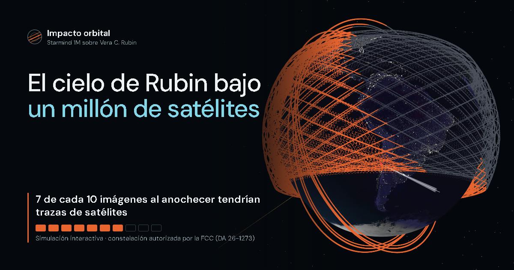

# Impacto orbital · Starmind sobre Vera C. Rubin

**Español** · [English](README.en.md)

[](https://hungerforcoffe.github.io/starmind_demonstration/)

Simulador 3D interactivo del daño que la megaconstelación **Starmind** de SpaceX causaría en las observaciones del **Observatorio Vera C. Rubin** (Cerro Pachón, Chile). Starmind contempla hasta 1.000.000 de satélites que funcionarían como centros de datos en órbita; la FCC la autorizó el 25-nov-2026 (DA 26-1273).

### ▶ [Abrir el simulador](https://hungerforcoffe.github.io/starmind_demonstration/)

Corre en el navegador y no hay que instalar nada. La interfaz está en español.

---

## Motivación

Los estudios existentes sobre megaconstelaciones y astronomía (Tyson et al. 2020; Hainaut & Williams 2020; Bassa et al. 2022) trabajan con decenas de miles de satélites. Starmind sube la escala en más de un orden de magnitud y agrega capas heliosincrónicas que siguen iluminadas durante el crepúsculo. Este proyecto busca dos cosas:

1. **Ver** la constelación completa a escala real, alrededor de la Tierra y en el cielo de Rubin, en cualquier fecha y hora.
2. **Cuantificar** su efecto en las imágenes de LSSTCam (trazas por exposición, saturación y fracción de píxeles perdidos) con una cadena de cálculo trazable. Cada parámetro indica su fuente y si es un dato confirmado o un supuesto.

## Resultados principales (noche del 26/27-nov-2026)

Starmind solo, 200 apuntados al azar sobre 30° de altura, exposiciones de 30 s:

| Hora (Chile) | Sol | Las 6 capas: imágenes con trazas (de 10) · trazas por imagen | Solo capas bajo 600 km |
|---|---|---|---|
| 21:30 | −12,7° | 6,9 · 29,9 | 6,7 · 3,9 |
| 22:00 | −17,9° | 6,8 · 28,8 | 6,0 · 3,2 |
| 22:30 | −22,8° | 4,3 · 18,9 | 2,5 · 1,1 |
| 23:00 | −27,2° | 1,4 · 9,8 | 0,1 · 0,1 |
| 00:00 | −34,2° | 0,1 · 0,5 | 0 · 0 |
| 01:30 (medianoche solar) | −38,6° | 0 · 0 | 0 · 0 |
| 04:00 | −27,3° | 1,7 · 8,8 | 0,1 · 0,0 |
| 04:30 | −22,9° | 4,5 · 19,1 | 2,5 · 1,3 |
| 05:00 | −18,1° | 6,7 · 24,0 | 6,3 · 3,3 |

- **El daño se concentra en las horas que siguen al anochecer y en las que preceden al amanecer.** A medianoche, la sombra de la Tierra sobre el cenit de Rubin nunca baja de ~1.550 km, y Starmind orbita a ≤ 1.002 km.
- **Al fin del crepúsculo astronómico (22:01)** hay ~6.400 satélites de Starmind iluminados sobre 30°. Con Starlink actual (11.189 satélites) son ~30–50, y ~0,3 trazas por imagen.
- **Las capas altas son las que alargan el problema.** Con solo las capas bajo 600 km, las únicas con plan de desechos aprobado por ahora, el período afectado termina ~1 h antes por la tarde y empieza ~1 h después por la mañana. Al anochecer, la fracción de imágenes afectadas casi no cambia, pero hay unas 9 veces menos trazas por imagen.
- **El brillo es la mayor incertidumbre.** El brillo del satélite AI1 no se ha medido; el rango plausible es M₁₀₀₀ = 2,7–6,0, unas 3 magnitudes. El número de trazas no depende del brillo; la saturación y las máscaras sí. En un mismo campo, la imagen perdida puede pasar de ~1 % a ~20 % entre el caso central y el pesimista.

## Cómo se usa

### Modo simple (para cualquier persona)

- **Constelaciones:** casillas para Starmind, Starlink actual y Starlink Gen2. La página parte solo con Starmind. Para Starmind se elige entre «Todas sus capas» y «Solo bajo 600 km».
- **Hora:** un deslizador recorre la noche, de la puesta a la salida del sol.
- **Impacto estimado:** «X de cada 10 imágenes saldrían con trazas de satélites», con el promedio de satélites por foto, calculado en vivo con 200 apuntados al azar.
- **Exposición:** tocar un punto del cielo toma ahí una exposición de 30 s y muestra lo que vería LSSTCam. Al abrir se muestra un ejemplo típico: de 31 campos al azar, el de la mediana de trazas.
- **Imagen perdida:** se muestra con dos casos al mismo nivel, «si los satélites se oscurecen como los Starlink actuales» y «si no se oscurecen».

### Modo avanzado

- **Tiempo:** cualquier fecha y hora, reproducción acelerada y atajos (fin del crepúsculo, medianoche solar, inicio del alba, solsticio de invierno).
- **Escenarios:** casillas, capas de Starmind, deslizador de fracción desplegada según los hitos de la FCC, editor de capas (altitud, inclinación, N, planos, LTAN) y actualización de TLE desde CelesTrak.
- **Sombra terrestre:** cilíndrica o cónica con penumbra. Cambia qué satélites están iluminados.
- **LSSTCam:** clic en el cielo o coordenadas alt/az o RA/Dec (J2000) para apuntar y exponer. Bajo la imagen están el brillo de Starmind (optimista 6,0, central 5,7, pesimista 2,7 o personalizado), la banda u–y, el modo 1 × 30 s o 2 × 15 s y la función de fase de Mallama 2023. Estos solo cambian cómo se ve cada satélite, no cuántos cruzan.
- **Pestañas:**
  - **Gráfico de la noche:** iluminados sobre 30° y trazas por exposición en toda la noche, por escenario.
  - **Exposición:** detalle de la última exposición y estadística en N apuntados al azar.
  - **Fuentes y supuestos:** cada parámetro con su estado (CONFIRMADO, SECUNDARIA, DERIVADO, SUPUESTO, MODELO, NO PÚBLICO) y su fuente.
  - **Diagnóstico:** pruebas automáticas dentro de la página, con resultado PASA o FALLA.

### Celular

La página detecta celulares y dibuja 1 de cada 10 satélites de Starmind para que las vistas fluyan. Los números siempre se calculan con la constelación completa.

### Parámetros de URL

| Parámetro | Efecto |
|---|---|
| `?modo=simple` · `?modo=avanzado` | Abre en ese modo (por defecto, simple; la página recuerda la última elección) |
| `?t=2026-11-27T01:00:00Z` | Abre en una fecha y hora UTC concreta (por defecto, el fin del crepúsculo astronómico de hoy) |
| `?diag=1` | Abre el modo avanzado y corre el diagnóstico |
| `?lite` · `?full` | Fuerza el modo liviano de celular, o lo desactiva |

## Lo que dice la FCC (DA 26-1273, 25-nov-2026)

Contrastado con el texto completo de la autorización y del aviso público DA 26-113:

- **Qué se autorizó.** Hasta 1.000.000 de satélites en capas de 50 km entre 500 y 1.002 km, en 6 grupos: 550–568 km a 26–32°; 565–585 km a 97,7°; 686–718 km a 30°; 707–744 km a 97,2°; 946–978 km a 30°; 967–1.002 km a 99,4°. La grilla de capas viene de una carta de SpaceX del 29-may-2026.
- **Cómo se reparten los satélites.** La orden no dice cuántos van en cada capa. El simulador usa la lista de 114 subcapas de McDowell escalada al máximo: 999.996 satélites con números enteros por plano. Los planos orbitales quedaron fuera del Schedule S: la FCC concedió el waiver «por limitaciones técnicas del software del Schedule S» (condición 7).
- **Basura espacial y la diferencia de los 600 km.** La FCC solo aprobó el plan de desechos para los satélites bajo 600 km (¶11). Para desplegar cualquiera de las 4 capas superiores, SpaceX debe presentar una modificación con un plan definitivo, y su pedido de llevarlos a órbitas de descarte o heliocéntricas quedó diferido (condición 4). Por eso el simulador tiene el escenario «solo bajo 600 km».
- **Despliegue de prueba.** SpaceX probará los satélites a menor altitud, «bajo otros sistemas operativos», antes de subirlos a su capa (¶12–13). El modelo, de estado estacionario, no incluye esa población transitoria.
- **Hitos.** El primer satélite debe estar operando antes del 25-nov-2033, el 10 % antes de 2035, el 50 % antes de 2038 y el 100 % antes de 2040 (condición 10). La licencia de 15 años es un plazo legal, no la vida útil de cada satélite (condición 11).
- **Astronomía óptica.** No hay ninguna condición: la FCC considera suficiente el compromiso de SpaceX de coordinar con la NSF (¶16) y declara fuera de su competencia el infrarrojo térmico que planteó la AAS (¶17). Denegó las peticiones de la AAS, Amazon Kuiper y Viasat (¶20).
- **Brillo.** Dark Sky señala que SpaceX no se comprometió a reducir la reflectividad, y la FCC no impone nada al respecto (nota 52). Por eso el caso central, que supone una mitigación como la de la Starlink V2 Mini, se muestra siempre junto al pesimista.
- **Consulta a otras agencias.** La FCC da por cumplida la consulta formal que pedían los astrónomos con la coordinación vía NTIA con NASA, NOAA y «organizaciones astronómicas federales» (nota 51).
- **Otras objeciones.** Descarta la objeción del SKA sobre reflexión de radio por falta de respaldo técnico (¶5) y califica de «especulativos» los efectos del reingreso en la atmósfera (¶15).
- **Datos futuros.** SpaceX deberá informar cada 6 meses los acercamientos, las maniobras y los parámetros orbitales de todo lo desplegado (condición 6). Cuando empiece el despliegue, esa será una fuente de datos reales para el simulador.
- **Inconsistencia del documento.** La portada y el aviso público fechan la solicitud el 30-ene-2026; una nota del cuerpo de la orden dice «Jan. 20».

La revisión fila por fila está al final de [`FASE1_FASE2.md`](FASE1_FASE2.md).

## Modelo físico

| Componente | Implementación |
|---|---|
| Órbitas Starmind / Gen2 | Circulares, con precesión secular J2 del nodo y del argumento de latitud. Las capas heliosincrónicas mantienen el RAAN fijo respecto del Sol (LTAN 18:00 / 06:00) |
| Starlink actual | SGP4 (satellite.js) sobre los TLE de CelesTrak; snapshot incluido o descarga en vivo |
| Tiempo y marcos | GMST IAU-82, precesión IAU 1976, observador WGS-84 |
| Sol | Fórmula de baja precisión del Astronomical Almanac (~0,01°) |
| Sombra | Cilíndrica (por defecto) o cónica (umbra y penumbra con transición lineal) |
| Brillo | m = M₁₀₀₀ + 5 log₁₀(ρ/1000 km) − 2,5 log₁₀(f_iluminada), con función de fase opcional |
| Trazas | Intersección del segmento recorrido en 30 s con el campo de LSSTCam, en el plano tangente |
| Fotometría | Punto cero por banda, PSF 0,67″, desenfoque 206265·D/ρ con D = 8,36 m, pozo lleno de 130.000 e⁻ |
| Máscaras | 20″ (normal), 100″ (saturada), CCD completo si m < 2 (convención de Jangid et al. 2026) |

La propagación ocurre en un vertex shader de WebGL, y la misma fórmula está duplicada en JavaScript para los cálculos de la CPU (exposiciones, estadística, gráfico). El diagnóstico verifica que ambas coincidan.

## Supuestos principales

| Parámetro | Valor usado | Estado |
|---|---|---|
| Grupos orbitales (altitud / inclinación) | 6 grupos entre 550 y 1.002 km, a 26–32°, 30° y ~97–99° | Confirmado (DA 26-1273) |
| N por subcapa | Lista de McDowell (1.198.120) escalada ×0,83464, con satélites enteros por plano: 999.996 | Secundaria + supuesto |
| LTAN de las órbitas heliosincrónicas | 18:00 y 06:00 (dawn-dusk) | Supuesto (el más influyente en la distribución en el cielo) |
| Fase dentro de cada plano | Uniforme, con desfase aleatorio por plano | Supuesto |
| M₁₀₀₀ de Starmind | 6,0 / 5,7 / 2,7 (optimista / central / pesimista), escalado por área desde la V2 Mini | Supuesto derivado |
| Exposición | 30 s continuos, análisis con alt ≥ 30° | Supuesto (convención) |

El primer documento a conseguir del expediente ICFS para reemplazar supuestos es la carta de SpaceX del 29-may-2026. El detalle completo con citas está en [`FASE1_FASE2.md`](FASE1_FASE2.md) y en el panel de fuentes del simulador.

## Validación

El modo diagnóstico corre 19 pruebas más 1 informativa. Todas pasan en una GPU GeForce GTX 1060 Max-Q:

| Prueba | Obtenido | Referencia |
|---|---|---|
| Satélites sobre el horizonte y sobre 30° para 1.600 satélites a 550 km | 63,5 / 6,19 | 63,5 / 6,2 (Hainaut & Williams 2020) |
| Altura del Sol a la medianoche solar del 26/27-nov-2026 | −38,64° | −38,64° (astropy) |
| Altura de la sombra sobre el cenit | idéntica | R⊕(sec D − 1), analítico |
| Trazas por exposición, caso de Bassa et al. 2022 | 0,247 ± 0,011 | 0,245 (su Ec. 1) |
| Starmind iluminados sobre 30° al fin del crepúsculo | 6.422 | 6.408 (script Python independiente) |
| Posiciones GPU vs CPU | Δ máx. 0,00016° | < 0,01° |
| SGP4 vs caso de verificación de Vallado | Δ = 0 m | ±1 m |
| Rendimiento con ~1.026.000 satélites | 105–118 fps | ≥ 30 fps |

La tabla completa y la discusión están en [`FASE3_FASE4.md`](FASE3_FASE4.md).

## Limitaciones

- El brillo usa un solo M₁₀₀₀ difuso, sin BRDF y sin destellos especulares de los paneles. El caso pesimista sirve como cota.
- El LTAN de las capas heliosincrónicas es el supuesto que más cambia la distribución en el cielo.
- Las órbitas son idealizadas: estado estacionario, sin arrastre, sin maniobras y sin la población de prueba a menor altitud.
- No se modela el infrarrojo térmico de los radiadores.
- Los apuntados son aleatorios, no la cadencia real del scheduler de LSST (opsim). Por eso las fracciones no se comparan punto a punto con Jangid et al. (2026).
- La pérdida de píxeles es un orden de magnitud, no una cifra precisa.
- Los TLE de Starlink se degradan ~1–3 km por día. Para fechas lejanas conviene usar el escenario Gen2.

## Requisitos

- Navegador actualizado con WebGL 2: Chrome o Edge 96+, Firefox 108+ o Safari 16.4+ (en iPhone, iOS 16.4 o posterior).
- Conexión a internet: Three.js, satellite.js y las texturas de la Tierra se cargan desde jsDelivr.
- Si algo falla, la página muestra un mensaje que explica la causa (navegador antiguo, sin WebGL 2, red que bloquea jsDelivr) y qué hacer.
- Se recomienda una GPU dedicada; con gráficos integrados funciona, pero a menos fps.

## Estructura del repositorio

| Ruta | Contenido |
|---|---|
| `index.html` | El simulador completo en un solo archivo (es lo que sirve GitHub Pages) |
| `og.png` | Imagen de vista previa al compartir el enlace (1200×630) |
| `desarrollo/` | Fuentes: `core.js` (física, sin interfaz), `main.js` (escena, shaders, interfaz), `template.html` (estilos y diseño), `build.py` (genera `index.html` y contiene la tabla de fuentes), `test_core.mjs` (pruebas del núcleo con Node) |
| `referencia/` | Textos de la FCC, lista de subcapas de McDowell, snapshot GP de Starlink del 26-nov-2026 y scripts Python de referencia (`reference.py`, `montecarlo.py`) |
| `FASE1_FASE2.md` | Investigación de fuentes, arquitectura, casos verificables a mano, plan de pruebas y revisión contra el texto completo de la FCC |
| `FASE3_FASE4.md` | Resultados del diagnóstico, limitaciones y qué cambiaría con mejores datos |
| `LICENSE` | Licencia MIT |

Para regenerar el HTML después de editar las fuentes:

```
cd desarrollo
python build.py
node test_core.mjs
```

## Licencia

El código y la documentación de este repositorio se publican bajo la [licencia MIT](LICENSE): se pueden usar, modificar y redistribuir citando la autoría.

Los datos de terceros en `referencia/` y en el snapshot de TLE conservan sus propias condiciones: documentos de la FCC, catálogo de J. McDowell y elementos orbitales de CelesTrak. `desarrollo/satellite.es.js` es satellite.js, también bajo licencia MIT. Si usas los resultados, cita las fuentes originales listadas abajo.

## Referencias principales

- FCC DA 26-1273 (25-nov-2026), autorización de Starmind; DA 26-113 (aviso público de la solicitud); DA 26-36 (Starlink Gen2).
- J. McDowell, *Enormous Constellations*, planet4589.org.
- Jangid et al. 2026, arXiv:2610.31772, y su código público.
- Tyson et al. 2020, AJ 160, 226.
- Hainaut & Williams 2020, A&A 636, A121.
- Bassa et al. 2022, A&A 657, A75.
- Mallama et al. 2023, arXiv:2306.06657 (fotometría de la Starlink V2 Mini).
- Ivezić et al. 2019, ApJ 873, 111 (parámetros de LSST).
- CelesTrak, elementos GP de Starlink.
